<!--
  Todo lo visual de este perfil son SVG animados hechos a mano, sin servicios externos:
  - assets/dark, assets/light → node scripts/build-assets.mjs (componentes en scripts/components);
                       el README elige la variante con <picture> según el tema de GitHub
  - rama `metrics`   → scripts/generate-metrics.mjs (dark/ y light/), lo ejecuta .github/workflows/metrics.yml cada día
  - rama `output`    → la serpiente de contribuciones (.github/workflows/snake.yml)
-->

  <picture><source media="(prefers-color-scheme: dark)" srcset="./assets/dark/hero.svg" /></picture>

<a href="https://github.com/santiagoGal7"><picture><source media="(prefers-color-scheme: dark)" srcset="./assets/dark/buttons/github.svg" /></picture></a><a href="https://github.com/santiagoGal7?tab=repositories"><picture><source media="(prefers-color-scheme: dark)" srcset="./assets/dark/buttons/repos.svg" /></picture></a><a href="mailto:santiagogal7i@gmail.com"><picture><source media="(prefers-color-scheme: dark)" srcset="./assets/dark/buttons/email.svg" /></picture></a>

<!-- TODO: LinkedIn URL -->
<!-- TODO: URL del portafolio cuando esté público -->

<a href="#sobre-mi"><picture><source media="(prefers-color-scheme: dark)" srcset="./assets/dark/nav/sobre-mi.svg" /></picture></a><a href="#ahora"><picture><source media="(prefers-color-scheme: dark)" srcset="./assets/dark/nav/ahora.svg" /></picture></a><a href="#stack"><picture><source media="(prefers-color-scheme: dark)" srcset="./assets/dark/nav/stack.svg" /></picture></a><a href="#arquitectura"><picture><source media="(prefers-color-scheme: dark)" srcset="./assets/dark/nav/arquitectura.svg" /></picture></a><a href="#proyectos"><picture><source media="(prefers-color-scheme: dark)" srcset="./assets/dark/nav/proyectos.svg" /></picture></a><a href="#trayectoria"><picture><source media="(prefers-color-scheme: dark)" srcset="./assets/dark/nav/trayectoria.svg" /></picture></a><a href="#metricas"><picture><source media="(prefers-color-scheme: dark)" srcset="./assets/dark/nav/metricas.svg" /></picture></a><a href="#contacto"><picture><source media="(prefers-color-scheme: dark)" srcset="./assets/dark/nav/contacto.svg" /></picture></a>

 

  <picture><source media="(prefers-color-scheme: dark)" srcset="./assets/dark/headers/01-sobre-mi.svg" /></picture>

  <picture><source media="(prefers-color-scheme: dark)" srcset="./assets/dark/about.svg" /></picture>

  <picture><source media="(prefers-color-scheme: dark)" srcset="./assets/dark/headers/02-ahora.svg" /></picture>

  <picture><source media="(prefers-color-scheme: dark)" srcset="./assets/dark/now.svg" /></picture>

  <picture><source media="(prefers-color-scheme: dark)" srcset="./assets/dark/headers/03-stack.svg" /></picture>

  <picture><source media="(prefers-color-scheme: dark)" srcset="./assets/dark/stack.svg" /></picture>

  <picture><source media="(prefers-color-scheme: dark)" srcset="./assets/dark/headers/04-arquitectura.svg" /></picture>

  <picture><source media="(prefers-color-scheme: dark)" srcset="./assets/dark/architecture.svg" /></picture>

  <picture><source media="(prefers-color-scheme: dark)" srcset="./assets/dark/headers/05-proyectos.svg" /></picture>

  <a href="https://github.com/santiagoGal7/help-desk-back"><picture><source media="(prefers-color-scheme: dark)" srcset="./assets/dark/projects/helpdesk.svg" /></picture></a>

<a href="https://github.com/santiagoGal7/analizador_cv_agent"><picture><source media="(prefers-color-scheme: dark)" srcset="./assets/dark/projects/cv-agent.svg" /></picture></a><a href="https://github.com/santiagoGal7/Examen.NET_SantiagoGallo"><picture><source media="(prefers-color-scheme: dark)" srcset="./assets/dark/projects/autotaller.svg" /></picture></a>

<a href="https://github.com/santiagoGal7/Proyecto_IA_Nivel1_Santiago_Gallo--Kevin_Pico"><picture><source media="(prefers-color-scheme: dark)" srcset="./assets/dark/projects/agendabot.svg" /></picture></a><a href="https://github.com/santiagoGal7/HotelRincondelCarmen"><picture><source media="(prefers-color-scheme: dark)" srcset="./assets/dark/projects/hotel.svg" /></picture></a>

  Demos en vivo: <a href="https://dashing-lamington-b8a2d6.netlify.app/">Hotel El Rincón del Carmen</a> y <a href="https://luxtime-sg.netlify.app/">LuxTime</a>.

  <picture><source media="(prefers-color-scheme: dark)" srcset="./assets/dark/headers/06-trayectoria.svg" /></picture>

  <picture><source media="(prefers-color-scheme: dark)" srcset="./assets/dark/timeline.svg" /></picture>

  <picture><source media="(prefers-color-scheme: dark)" srcset="./assets/dark/headers/07-metricas.svg" /></picture>

  <picture><source media="(prefers-color-scheme: dark)" srcset="https://raw.githubusercontent.com/santiagoGal7/santiagoGal7/metrics/dark/overview.svg" /></picture>

<picture><source media="(prefers-color-scheme: dark)" srcset="https://raw.githubusercontent.com/santiagoGal7/santiagoGal7/metrics/dark/languages.svg" /></picture><picture><source media="(prefers-color-scheme: dark)" srcset="https://raw.githubusercontent.com/santiagoGal7/santiagoGal7/metrics/dark/rhythm.svg" /></picture>

  <picture><source media="(prefers-color-scheme: dark)" srcset="https://raw.githubusercontent.com/santiagoGal7/santiagoGal7/metrics/dark/activity.svg" /></picture>

  <picture>
    <source media="(prefers-color-scheme: dark)" srcset="https://raw.githubusercontent.com/santiagoGal7/santiagoGal7/output/github-contribution-grid-snake-dark.svg" />
    <source media="(prefers-color-scheme: light)" srcset="https://raw.githubusercontent.com/santiagoGal7/santiagoGal7/output/github-contribution-grid-snake.svg" />
    
  </picture>

  Métricas propias generadas cada día con la API GraphQL de GitHub y <a href=".github/workflows/metrics.yml">GitHub Actions</a>.

  <picture><source media="(prefers-color-scheme: dark)" srcset="./assets/dark/headers/08-contacto.svg" /></picture>

  <a href="mailto:santiagogal7i@gmail.com"><picture><source media="(prefers-color-scheme: dark)" srcset="./assets/dark/contact.svg" /></picture></a>

<b>Más proyectos y notas</b>

 

Otros repos públicos:

- [LuxTime](https://github.com/santiagoGal7/LuxTimeProject): tienda de relojes con Next.js 15, React Three Fiber y GSAP. [Demo en vivo](https://luxtime-sg.netlify.app/).
- [Gestor de Compañías](https://github.com/santiagoGal7/Gestor_de_Companias): CRUD de compañías, sucursales y ubicaciones con Web Components, Bootstrap y json-server.
- [Gestor de Contenido](https://github.com/santiagoGal7/Gestor_Contenido): app de consola en Python para una colección personal (libros, películas y música) con persistencia en JSON.
- [n8n-json](https://github.com/santiagoGal7/n8n-json): flujo de n8n para un agente de inventario y compras.

En el día a día también me apoyo en Cursor y en modelos como ChatGPT, Claude y Gemini.

  <picture><source media="(prefers-color-scheme: dark)" srcset="https://komarev.com/ghpvc/?username=santiagoGal7&label=visitas&color=F2762E&style=flat-square" /></picture>

  <picture><source media="(prefers-color-scheme: dark)" srcset="./assets/dark/footer.svg" /></picture>

