<!--
  Todo lo visual de este perfil son SVG animados hechos a mano, sin servicios externos:
  - assets/          → node scripts/build-assets.mjs (componentes en scripts/components)
  - rama `metrics`   → scripts/generate-metrics.mjs, lo ejecuta .github/workflows/metrics.yml cada día
  - rama `output`    → la serpiente de contribuciones (.github/workflows/snake.yml)
-->

  

  
  
  
  <!-- TODO: LinkedIn URL -->
  <!-- TODO: URL del portafolio cuando esté público -->

  
  
  
  
  
  
  
  

 

  

  

  

  

  

  

  

  

  

  <a href="https://github.com/santiagoGal7/help-desk-back"></a>

  <a href="https://github.com/santiagoGal7/analizador_cv_agent"></a>
  <a href="https://github.com/santiagoGal7/Examen.NET_SantiagoGallo"></a>

  <a href="https://github.com/santiagoGal7/Proyecto_IA_Nivel1_Santiago_Gallo--Kevin_Pico"></a>
  <a href="https://github.com/santiagoGal7/HotelRincondelCarmen"></a>

  ▶ Demos en vivo: <a href="https://dashing-lamington-b8a2d6.netlify.app/">Hotel El Rincón del Carmen</a> · <a href="https://luxtime-sg.netlify.app/">LuxTime</a>

  

  

  

  

  
  

  

  <picture>
    <source media="(prefers-color-scheme: dark)" srcset="https://raw.githubusercontent.com/santiagoGal7/santiagoGal7/output/github-contribution-grid-snake-dark.svg" />
    <source media="(prefers-color-scheme: light)" srcset="https://raw.githubusercontent.com/santiagoGal7/santiagoGal7/output/github-contribution-grid-snake.svg" />
    
  </picture>

  Métricas propias generadas cada día con la API GraphQL de GitHub y <a href=".github/workflows/metrics.yml">GitHub Actions</a>.

  

  <a href="mailto:santiagogal7i@gmail.com"></a>

<b>Más proyectos y notas</b>

 

Otros repos públicos:

- [LuxTime](https://github.com/santiagoGal7/LuxTimeProject): tienda de relojes con Next.js 15, React Three Fiber y GSAP. [Demo en vivo](https://luxtime-sg.netlify.app/).
- [Gestor de Compañías](https://github.com/santiagoGal7/Gestor_de_Companias): CRUD de compañías, sucursales y ubicaciones con Web Components, Bootstrap y json-server.
- [Gestor de Contenido](https://github.com/santiagoGal7/Gestor_Contenido): app de consola en Python para una colección personal (libros, películas y música) con persistencia en JSON.
- [n8n-json](https://github.com/santiagoGal7/n8n-json): flujo de n8n para un agente de inventario y compras.

En el día a día también me apoyo en Cursor y en modelos como ChatGPT, Claude y Gemini.

  

  

